<div align="center">

<picture>
  <source media="(prefers-color-scheme: dark)" srcset="docs/images/logo-dark.png">
  
</picture>

**Test it, research it, track it.**

Honest strategy backtests and paper trading in ten markets, company research for Indian (NSE and BSE) and US companies,
and your holdings, funds, net worth and tax. Facts, never tips.

### [stratlab.studio](https://stratlab.studio)


</div>

<picture>
  <source media="(prefers-color-scheme: dark)" srcset="docs/screenshots/landing-dark.png">
  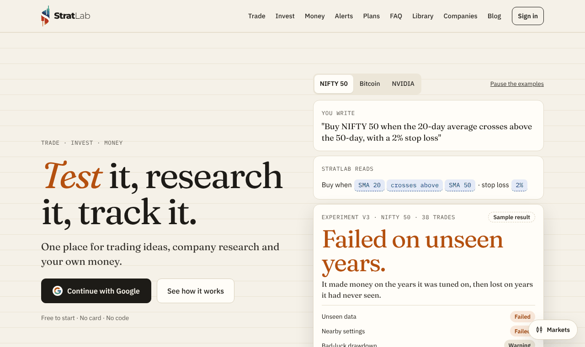
</picture>

## What it is

StratLab is one place to find out whether a trading idea has a real edge before any money is at risk, understand a
listed company, and keep track of what you own and what it means at tax time. It has three spaces, picked at the top of
the menu: **Trade** (the strategy lab), **Invest** (research) and **Money** (your own finances), each with its own home
page.

- **Facts, not advice.** Every number comes from reported results, exchange filings, the company's own documents,
  prices or your own files. StratLab never says buy, sell or hold, gives no price targets, ratings or quality scores,
  and never ranks stocks or funds. AI summaries restate the facts and nothing more.
- **Honest backtests.** Every strategy test ends in a plain verdict (*Likely a real edge* to *No edge here*) backed by
  four checks: unseen data, nearby settings, bad-luck drawdown and enough trades.
- **Paper trading only.** No real orders are ever placed, and no tax return is ever filed.

## Features

The full list, with where each thing lives in the app, is in **[docs/FEATURES.md](docs/FEATURES.md)**.

**Trade: the strategy lab**
- Notebooks: describe an idea in plain English (or Ask with Ctrl+K), tap any word to change a rule, run numbered experiments, compare them.
- Real costs per market, long/short/intraday rules, 20+ indicators, walk-forward tests, the similar-stocks check, group tests with one pot of capital, imports from Pine Script, Python, MetaTrader, AmiBroker and configs.
- Paper trading on live prices in every market, and option structures (up to eight legs) at the real bid and ask. Each session shows today first; earlier trades fold under one line with their total, and each trade's orders open under it.
- Options builder: charges to open and close, breakevens and the most it can make or lose before and after charges, each leg's IV and Greeks, and the payoff today beside the one at expiry, for everyone; what-if sliders (underlying, IV, days) and a roll preview on Pro. Greeks are model estimates, shown with their inputs.
- Each backtest's trades and paper session's stops and targets on the price chart, with the indicators the rules use.
- F&O changes (`/trade/fo-changes`): stocks entering and leaving F&O, lot-size revisions and expiry-day changes in one dated list, with badges and an alert when a change touches your watchlist or paper sessions (Basic).
- Positioning: who holds index and stock futures and options (clients, DIIs, FIIs, proprietary traders; long and short shares), FII/DII cash flows, each index's put-call ratio, max pain, open interest by strike and ATM IV, with their history.
- Forward test (`/trade/signals`): a secret webhook moves a paper session from your own TradingView or Chartink alerts, filled at StratLab's own price, with the signal log and the verdict's checks on the result (Pro).
- Chart replay (`/trade/replay`): practise on past candles bar by bar; each practice trade goes to the trade journal (Basic).
- Closing auction (`/trade/closing-auction`): the 15:15 to 15:35 auction's indicative and reference prices live, with 60 days of history on Basic.
- Market events (`/trade/events`): RBI policy, data releases, the Fed, budget, index changes, holidays and every F&O expiry in one calendar, with reminders on Basic.
- Stock futures and margin funding: each F&O stock's open interest, buildup, rollover, basis and MWPL use, and the market's and each stock's margin-funded positions, today for everyone, with history and alerts on Basic.
- Trade journal: your real trades from a tradebook or tax P&L (equity and F&O), paired into round trips after charges, with your notes and the verdict's honesty checks run on them.
- A strategy library of StratLab's own tested strategies, with samples for every market the backtester reads, each shown with the verdict it earned, good or bad (copy one and re-test it), and share cards and public links for verdicts.
- Lab notes: a tab on the bottom edge of a notebook for what you noticed and what to try next, seen only by you.
- Markets: India (stocks, indices, F&O), Indian currency futures, MCX, crypto, US, UK, Europe, Japan, forex, global commodities, and any CSV.

<picture>
  <source media="(prefers-color-scheme: dark)" srcset="docs/screenshots/trade-home-dark.png">
  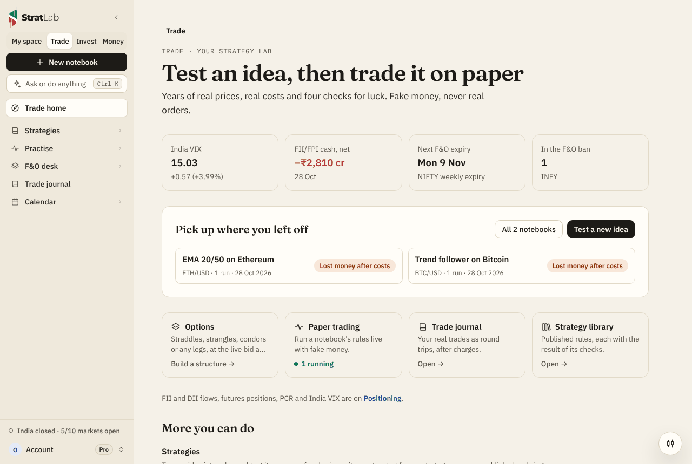
</picture>

<picture>
  <source media="(prefers-color-scheme: dark)" srcset="docs/screenshots/options-session-dark.png">
  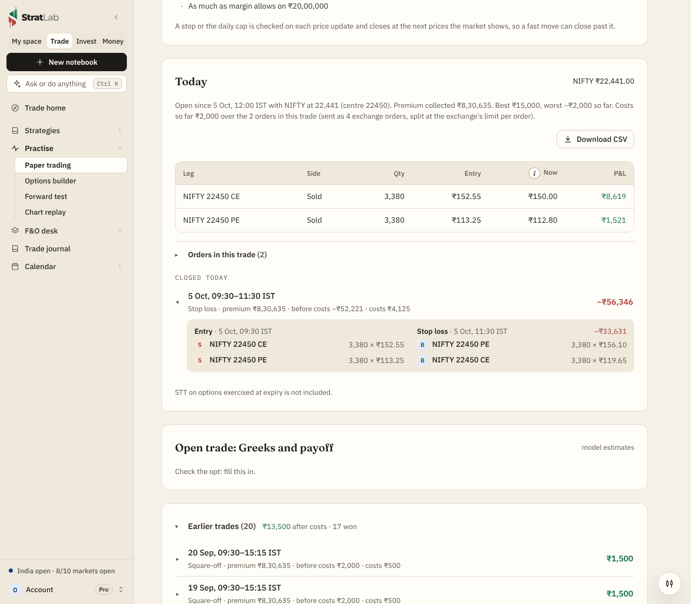
</picture>

<picture>
  <source media="(prefers-color-scheme: dark)" srcset="docs/screenshots/positioning-dark.png">
  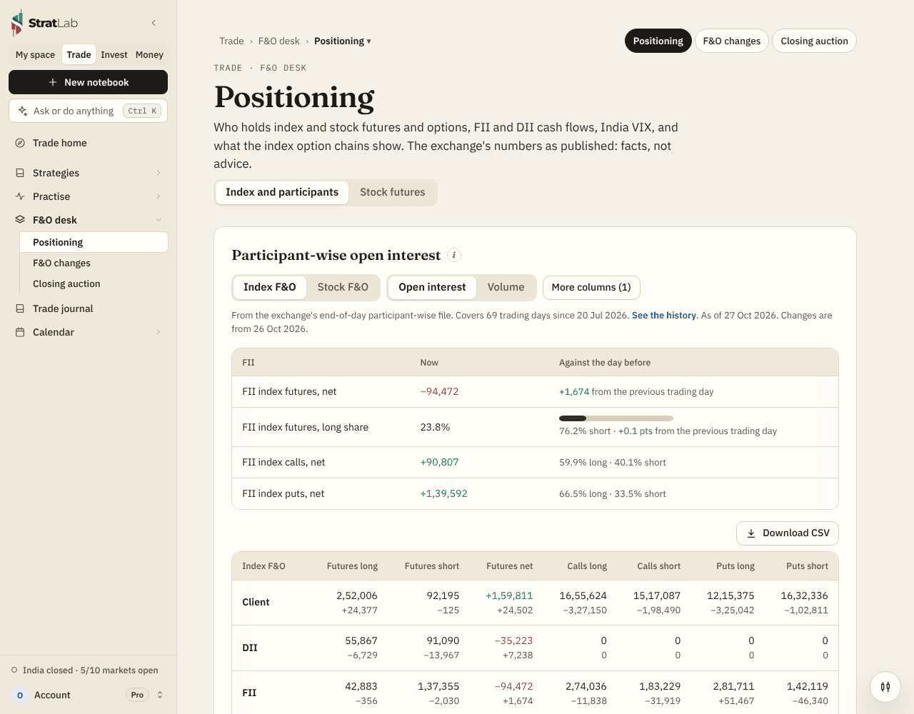
</picture>

<picture>
  <source media="(prefers-color-scheme: dark)" srcset="docs/screenshots/fo-changes-dark.png">
  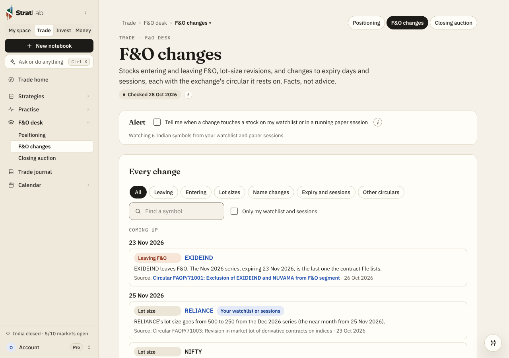
</picture>

<picture>
  <source media="(prefers-color-scheme: dark)" srcset="docs/images/verdict-dark.png">
  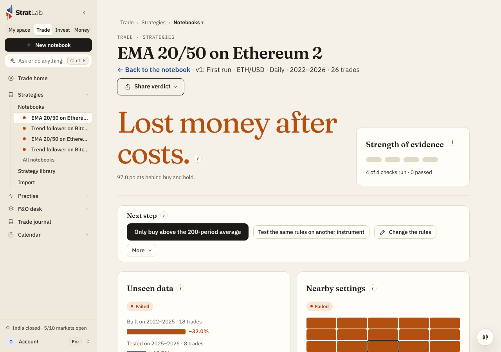
</picture>

**Invest: research**
- Market Watch on every page: named lists of any instrument the app covers (stocks, indices, crypto, forex, commodities), prices every 5 seconds and tick by tick where the broker's feed carries them, and a chart workspace with every timeframe from 1 minute to 1 month, drawings, indicators and the timeframe kept on your account per symbol (`/chart/<market>/<symbol>` as a page).
- Company pages for every Indian (NSE, and BSE-only) and US company, with a price chart (candles, Heikin-Ashi, bars, line; 1 minute to 1 month; indicators; drawings kept on your account; compare on a % scale), plus public facts pages at `/stocks/in/SYMBOL` and `/stocks/us/SYMBOL` for search engines.
- Deep dive: ten years of numbers, the business and its plans read from the company's own presentations, calls or 10-K, industry measures, valuation on the yardstick its industry uses, a management report card, an investor checklist, and the whole thing as PowerPoint or PDF slides.
- Themes (`/research/themes`): name a theme (defence, EVs, AI, railways, anything) and StratLab maps the listed companies in it, India or US: every company of the theme's official industries plus the ones whose own descriptions show the work, each placed in one layer of the value chain by how it earns, with each layer's revenue, margins and returns worked out from the companies' filed figures (medians only where a layer has enough comparable companies, and every count traced to the companies behind it). The whole theme downloads as a slide deck (PowerPoint or PDF) that passes a publication check before it is kept, and so does any company's deep dive. A finished theme read is kept once for everyone, so the same theme however it's written opens at once ("Ready to open"), until someone presses Refresh.
- Market mood (`/research/pulse`): the day in one page, every figure from one source: breadth, sectors, the stocks that moved the index, flows, volatility, currencies, other markets and today's calendar.
- Heatmap (`/invest/heatmap`): every company of an index as a tile, sized by market value and coloured by its move over a day to a year, grouped by sector or industry, for India and the US; a theme's companies grouped by layer. Flows (`/invest/flows`): the FIIs' and DIIs' buying and selling in the cash market, each day.
- IPOs (`/invest/ipos`): India's main-board and SME issues from NSE's and BSE's issue pages and SEBI's DRHP and RHP lists, and US IPOs from the IPO calendar and SEC filings, in tabs (upcoming, open, closed, listed, filed), with withdrawn issues kept apart. Each issue's page has its dates, price band, lot, size, bids by category while it is open, its documents and its trading since listing. A daily check compares the lists with the exchanges' and the regulator's own. The offer document's summary (each statement checked against a quote) and IPO alerts are on Basic.
- Business updates and named holders: monthly sales of automakers and quarterly figures of lenders read into numbers, and every holder named above 1% in a company's shareholding, searchable across companies and followed on Basic.
- Results calendar, corporate actions (dividends, bonuses, splits, buybacks, rights, demergers), deals and insider trades (including bulk and block deals), exchange surveillance lists (ASM, GSM, ESM, trade-to-trade, price bands, F&O ban), and filings with red flags.
- ETF vs NAV (`/invest/etf-gaps`): each Indian ETF's price against its last published NAV, widest gap first, with 30 days of history and a gap alert (Basic).
- Stock lending fees (`/invest/stock-lending`): what borrowing or lending shares costs in the exchange's lending market.
- Screens on plain facts, the Stage 2 + Supertrend scan, sector rotation, market breadth (advances and declines, stocks above their 20/50/200-day averages, new highs and lows, by group and sector), a watchlist and Watchlist at a glance, themes, market pulse, compare, News, and Markets now.

<picture>
  <source media="(prefers-color-scheme: dark)" srcset="docs/screenshots/invest-home-dark.png">
  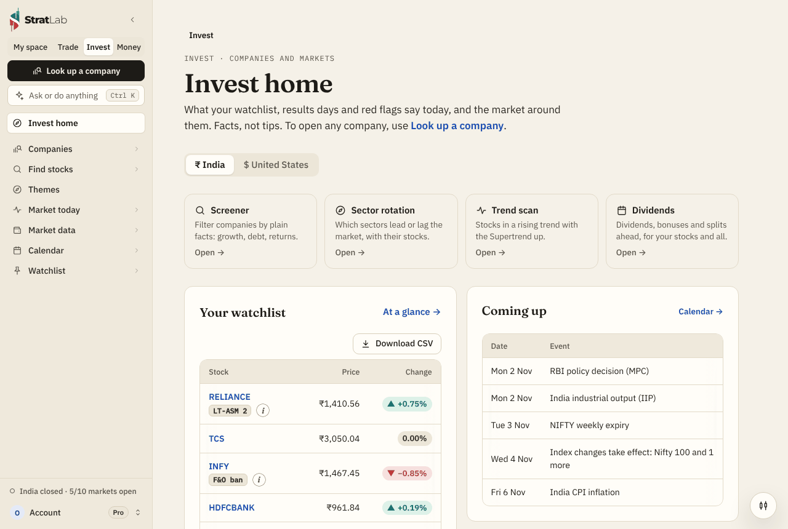
</picture>

<picture>
  <source media="(prefers-color-scheme: dark)" srcset="docs/screenshots/price-chart-dark.png">
  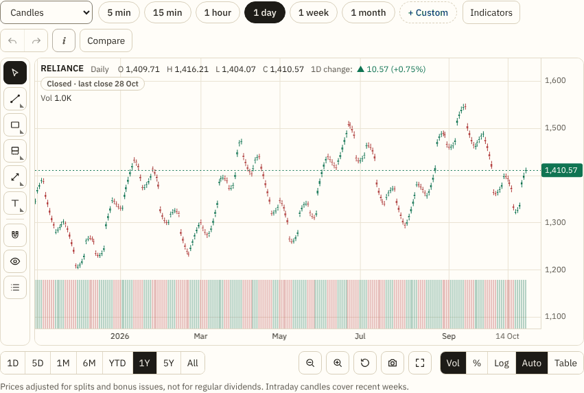
</picture>

<picture>
  <source media="(prefers-color-scheme: dark)" srcset="docs/screenshots/etf-gaps-dark.png">
  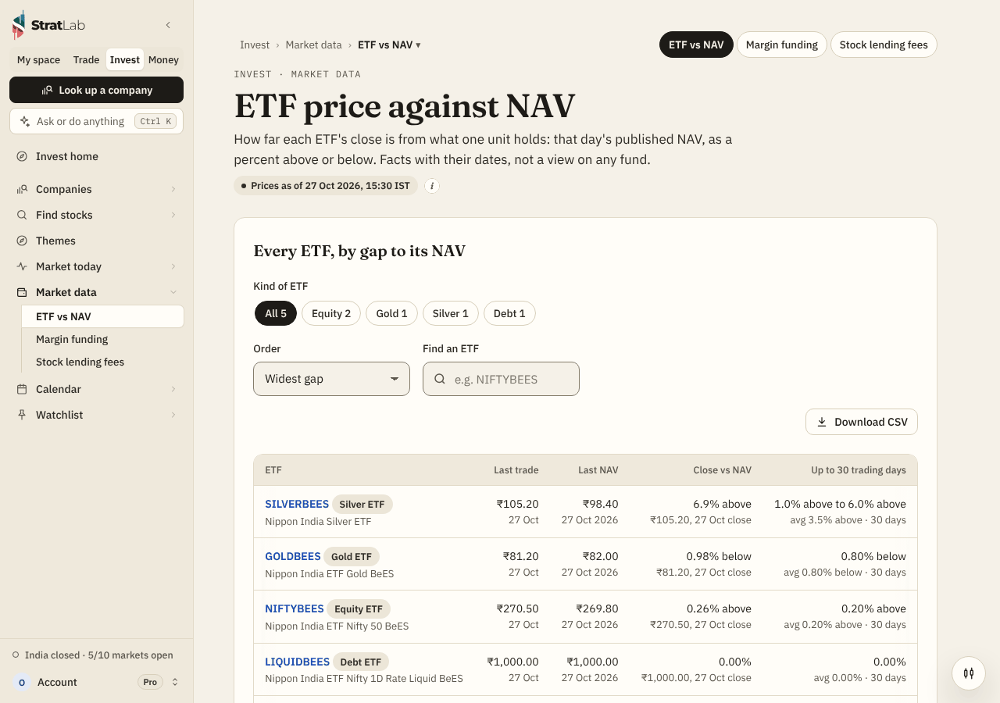
</picture>

<picture>
  <source media="(prefers-color-scheme: dark)" srcset="docs/images/deepdive-dark.png">
  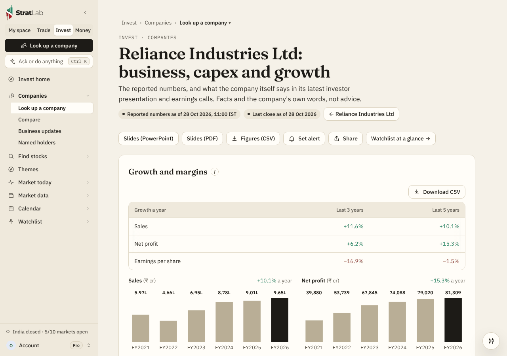
</picture>

**Money: what you own**
- My Holdings: import the holdings file from Zerodha, Groww, Upstox, Angel One, ICICI Direct or HDFC Securities (or any CSV or Excel file), add US stocks, and see value, P&L, sectors, dividends and one-click bonus and split adjustments. ETFs, REITs, InvITs and gold bonds keep their own label.
- Tax report: capital gains on listed Indian shares and funds from tradebooks, tax P&L files or the broker's ZIP of them, matched FIFO with the July 2024 rates, the yearly exemption, 2018 grandfathering and intraday apart; the year's total tax estimate with F&O, commodity and currency results, other income, either regime, age band and residency; CSV and PDF downloads.
- Mutual funds from the CAMS or KFintech CAS PDF, as one list of schemes: each row has the value, gain, XIRR and the TER in rupees a year, and a scheme's plans side by side, changes since you bought, SIP record and sales by year fold under it. Allocation by category and capital gains by year are cards above and below.
- Net worth: holdings and funds plus PF, PPF, NPS, deposits, gold, sovereign gold bonds, property, crypto and cash, minus loans (EMIs, prepayment arithmetic and a floating-rate loan check against its benchmark), an insurance register and a monthly history. A one-tap add for each kind.
- Tax tools: dividends with TDS, advance tax due by each date (with 234B and 234C) and the long-term exemption, lot by lot.
- US stocks in Indian tax: sales in rupees at the rate the Income-tax Rules use, the 24-month rule, US dividends and the foreign tax credit, and Schedule FA. Takes a trade list from any broker (an Interactive Brokers Flex Query export too) or a realised-gains tax report such as Vested's yearly one.
- ITR-ready export: the year laid out like the ITR-2 and ITR-3 schedules, as a spreadsheet, CSVs or one PDF for your CA. Not a filed return.
- Test a SIP (`/money/sip-test`): an amount every day, week or month into stocks or ETFs, with a step-up or a dip rule: charges, XIRR, the deepest fall and a lump sum beside it.
- Rates (`/money/rates`): this quarter's small savings rates, T-bill cut-offs, bond yields and the repo rate, each with its yield after tax at your rate.
- Money calendar: tax due dates, results and dividends for your stocks, maturities, premiums, EMIs and your own dates, with a private calendar feed and reminders.
- Every estimate states its assumptions and the date it's as of, and each page deletes its data in one step; **Delete my account** (Account, Your data) erases everything and the sign-in too, keeping only invoices as tax law asks. An estimate to check with a CA, not tax advice.

<picture>
  <source media="(prefers-color-scheme: dark)" srcset="docs/screenshots/money-home-dark.png">
  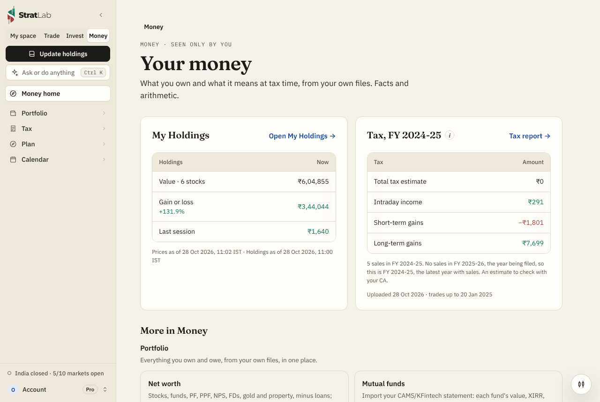
</picture>

**Alerts**
- Stock alerts (price, day move, moving average, RSI, Stage, 52-week high or low; for India, insider trades, deals and surveillance; an ETF's gap to its NAV), F&O contract changes touching your watchlist or paper sessions, results and corporate-action messages, the red-flag and Stage 2 alerts, market breadth crossing a level, every paper trade and a daily report, advance tax and money calendar reminders, the Market Brief and My Stocks newsletters, and a weekly email per saved screen.
- By phone notification (install from the browser), Telegram or email to a confirmed address.

**Everyday**
- Connected accounts: the broker holdings file and tradebooks, the funds statement, a private statements inbox (forward the email), and connections that update by themselves (Zerodha, IBKR, EPF, NPS and the tax statement).
- Briefs after each market close for India, the US and the companies you follow, also posted on the public blog (`/blog`) with a week in review every Saturday and research posts made from StratLab's own data; Ask (Ctrl+K) to find a page or do something in words.
- Feedback from the account menu, straight to the team; a loading bar wherever something takes a moment, never a raw error.
- Connect an AI assistant (Pro): keys that let Claude or ChatGPT read your StratLab and place paper orders in your own paper sessions, each key revocable.

**Getting started:** a first-steps checklist on each space's home (a backtest, a watchlist, a deep dive, paper trading, alerts), a short tour, share cards for a company's facts, and invite rewards (a free month of Basic for both once a friend is active).

More screenshots are in [docs/screenshots](docs/screenshots) and [docs/images](docs/images); `stratlab/frontend/scripts/docs-shots.spec.ts` retakes the ones in docs/screenshots. <sub>Screenshots use synthetic sample data, not real market data.</sub>

## Plans

Limits live in [`plans.py`](stratlab/backend/app/plans.py) and are enforced on the server. The website's copy of them,
[`frontend/src/lib/plans.ts`](stratlab/frontend/src/lib/plans.ts), is checked against it by
`backend/tests/test_plan_copy.py` (prices, limits, and each paid feature named on the card of the plan that adds it),
and the landing page's e2e test checks the plans it shows against the server's.

| | Free | Basic | Pro |
|---|---|---|---|
| Price (rupee prices include 18% GST) | ₹0 | ₹699 a month (₹6,999 a year) · $8 | ₹1,999 a month (₹19,999 a year) · $20 |
| Backtests, each with a verdict | 5 a month | 100 a month | Unlimited |
| AI strategy builds | 5 a month | 100 a month | Unlimited (a daily safety cap applies) |
| Paper trading | 1 session, for 5 market days | 2 at a time | 10 at a time |
| Instruments in a group test | 5 | 25 | 50 |
| Company deep dives (each company counted once a month) | 1 a month | 15 a month | Unlimited |
| Slide decks, of a company or a theme (its PDF and PowerPoint are one deck) | None (a sample deck to download) | 5 a month | Unlimited |
| New themes mapped (every theme already in the library opens on every plan) | 1 a month | 10 a month | Unlimited |
| Fresh AI reads a day, refreshes included (a read already written never counts; Free gets the Basic/Pro read when there is one) | 5 | 60 | Unlimited |
| AI answers in the search box a day | 10 | 40 | 40 |
| Refresh of a stored result (a theme, its figures, an AI read): each Refresh is one fresh AI read | None | ✓ | ✓ |
| Market Watch lists / symbols in a list / charts that keep drawings / indicators on a chart | 1 / 20 / 3 / 3 | 10 / 100 / Unlimited / 10 | Unlimited |
| Stock alerts on at once / saved screens (running a screen has no limit) / holdings kept | 3 / 1 / 30 | 25 / 10 / 100 | 100 / 25 / 300 |
| Mutual fund schemes / Net worth entries / trades the journal keeps | 5 / 5 / 50 | Unlimited | Unlimited |
| All 20+ indicators in strategy rules (Free: price, SMA, EMA, RSI; price charts show every indicator on every plan) | – | ✓ | ✓ |
| Group and options paper trading, trade notifications, daily report | – | ✓ | ✓ |
| Stage 2 scan, watchlist red flags, Watchlist at a glance, with alerts | – | ✓ | ✓ |
| Daily Market Brief and My Stocks (weekly for everyone) | – | ✓ | ✓ |
| Trade journal in full (honesty checks, breakdowns, paper vs real); positioning and market breadth history | – | ✓ | ✓ |
| Mutual fund capital gains, fund costs in rupees (parts, both plans, changes), Net worth history, dividends by company with TDS, money calendar reminders | – | ✓ | ✓ |
| The tax report's CSV and PDF downloads (the report on screen is for everyone) | – | ✓ | ✓ |
| F&O change alerts, ETF gap alerts | – | ✓ | ✓ |
| IPO offer-document summaries and IPO alerts; business updates in numbers and named holders search; chart replay; market event reminders | – | ✓ | ✓ |
| Stock futures and margin-funding history with their alerts; closing auction history; the India VIX filter on options sessions | – | ✓ | ✓ |
| Fund behaviour, the SIP test's dip rules, rates after tax at your own rate, the floating-rate loan check | – | ✓ | ✓ |
| Indian F&O, options on your own signals, options what-if sliders and roll preview, strikes picked by delta or premium, faster group entries, export | – | – | ✓ |
| Forward test from TradingView or Chartink alerts; StratLab in your AI assistant | – | – | ✓ |
| Advance tax amounts and the long-term exemption lot by lot, US stocks in Indian tax, the ITR-ready export | – | – | ✓ |
| Every market, company pages and price charts, every theme already mapped and the heatmap, the options builder with Greeks, the payoff today and breakevens after charges, F&O changes, ETF vs NAV, IPO lists, pages and bids, the events calendar, today's closing auction, stock futures and margin funding, each fund's TER in rupees, a plain SIP test, rates, screens, rotation, results, corporate actions, deals, surveillance, red flags on any company, today's positioning and breadth, My Holdings, the tax report on screen and total tax estimate, the money calendar and its feed, share cards, invites | ✓ | ✓ | ✓ |

Free is a teaser: the public pages and everything already written (company reads, themes in the library) are for everyone, and the
counts above are kept small. Accounts made before the change (`FREE_TIER_CHANGE_AT` in
[`config.py`](stratlab/backend/app/config.py)) keep Free's earlier counts (10 backtests and AI builds, 2 deep dives, 1 deck, 60 AI
reads with Refresh, 40 search answers, 5 alerts, 2 screens, groups of 10, the tax report downloads) for 14 days after it, and see a
one-time notice on Account and My space saying what changes and when; no email is sent.

Invite rewards give free months of Basic. Visitors outside India see prices in their own currency; every payment gets a
GST invoice.

<picture>
  <source media="(prefers-color-scheme: dark)" srcset="docs/screenshots/pricing-dark.png">
  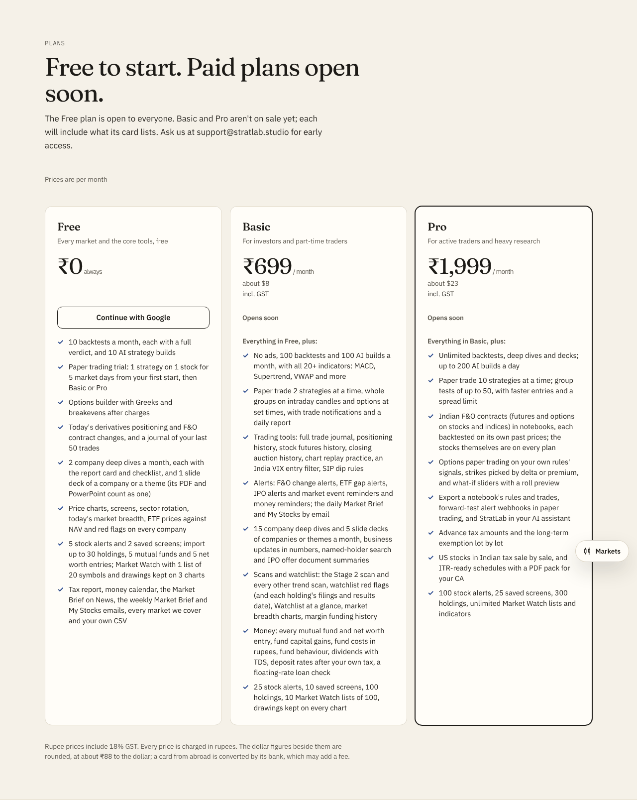
</picture>

## Architecture

- **Frontend** (`stratlab/frontend`): a Vite + React 19 + TypeScript single-page app.
- **Backend** (`stratlab/backend`): a FastAPI app with the backtest engine, the verdict checks, live paper trading,
  company research and the money tools. It keeps every key on the server; the browser talks only to it and to sign-in.
- **Database and sign-in:** Postgres, with Google sign-in through Supabase (`stratlab/supabase/schema.sql`).
- The same engine runs backtests, the verdict checks and live paper trading, so a strategy behaves the same everywhere.
- Results that are the same for everyone (a theme's read and figures, its deck, AI reads) are worked out once and kept in one shared
  store (`backend/app/computed.py`). A theme's read, its figures and its deck are keyed by the versions of the rules that made them,
  so a rules change works them out again rather than serving the old ones.

```
stratlab/
├── backend/app/      the API, the backtest engine, market data, company research and one module per feature
├── backend/tests/    pytest, against a fake world of synthetic market data
├── frontend/src/     pages, components (the shared chart system), lib (API client, formatting)
├── frontend/e2e/     Playwright browser tests and the UI layout checker
└── supabase/         schema.sql
docs/                 FEATURES.md, ADMIN.md, UI_CHECKER.md, AI_ASSISTANT.md, ROADMAP.md, images/, screenshots/
```

## Local setup

```bash
# backend
cd stratlab/backend
python -m venv .venv && source .venv/bin/activate
pip install -r requirements.txt
cp .env.example .env          # fill in what you need; everything but Supabase is optional
uvicorn app.main:app --reload --port 8000

# frontend (another terminal)
cd stratlab/frontend
npm install
npm run dev                   # http://localhost:5500; point public/config.js at http://localhost:8000
```

`stratlab/backend/.env.example` lists the settings the backend reads. The **[setup guide](stratlab/README.md)** has
more on running it locally.

## Tests

```bash
cd stratlab/backend && python -m pytest -q -n auto          # backend (pytest-xdist)
cd stratlab/frontend && npx tsc --noEmit && npm run build   # frontend typecheck and build
cd stratlab/frontend && npm run test:unit                   # frontend unit tests
cd stratlab/frontend && npx playwright test                 # browser tests against the fake world
cd stratlab/frontend && npm run ui-lint                     # the layout checker, after a build
```

The tests run on synthetic data only. The layout checker is described in **[docs/UI_CHECKER.md](docs/UI_CHECKER.md)**.

## Deploys

Every pull request runs the backend tests, the frontend build, the browser tests (in six parts) and the layout checker on
GitHub Actions, and merges once they all pass. The merged build then deploys by itself: the backend is built from its
`Dockerfile` (Python and PyPI packages only) on Railway, and the frontend is built by Vite and served by Vercel. After a
deploy, Admin → System → **Check every feature** runs every feature against the live site.

## What's new

The [changelog](CHANGELOG.md) has one line per release, up to Release 39 (12 November 2026); the [roadmap](docs/ROADMAP.md)
lists what's next. More:
[what StratLab does and where to find it](docs/FEATURES.md) and [StratLab in your AI assistant](docs/AI_ASSISTANT.md).

## Security

Please report security problems privately: see [SECURITY.md](SECURITY.md).

## Disclaimer

StratLab is a research and paper trading tool. It places no real orders and gives no investment advice, and past
backtest results don't predict future returns.

## License

Proprietary. © 2026 Prakul Bansal. All rights reserved. See [LICENSE](LICENSE).
